<div align="center">

# 📋 whatsop

**How sopc, sopserve and what comes next fit together.**

The concepts behind managing instructions for many task-driven agents:<br>
what a block is, how an agent is built from blocks, and how a change gets from an edit to a live call.

[Glossary](#glossary) · [The problem](#the-problem) · [Blocks](#blocks) · [Agents](#agents) · [Compiling](#compiling) · [Changing things safely](#changing-things-safely) · [Serving](#serving-prompts-at-call-time) · [The loop](#the-loop)

</div>

---

## Glossary

| Term | Meaning |
|---|---|
| Block | A reusable piece of instruction: a shared instruction or a procedure. |
| Shared instruction | Prompt text that isn't a procedure: identity, tone, policy, facts. |
| Procedure (SOP) | Goal, when it applies, steps (with tools), never-do's, warning signs. |
| Group | A named, ordered list of blocks that agents list as one. |
| Agent | Platform id, context, an ordered list of blocks, variables. |
| Context | Text only one agent gets; first in its prompt. |
| Variable | A `{{placeholder}}` in a block, filled per agent. |
| Compile | Agent + blocks + variables → one prompt. |
| Lock file | The prompt's hash and the exact blocks in it. |
| Plan | Which agents a change touches, with prompt diffs. |
| Affected | Just the list of changed agents, for CI. |
| Lint | Duplicates, drift and contradictions across an agent's blocks. |
| Behavior gate | Evals on the affected agents; block the change on regressions. |
| Verify | Compare live platform prompts with the compiled ones. |
| Draft / Release | Saved-but-unseen edits / the snapshot agents are served. |

## The problem

A team running one agent per customer ends up with dozens of long prompts, mostly copies of each other. A policy change means editing every one by hand. Copies drift: one agent upsells "once per call", another "twice", and nobody remembers which was intended. When a call goes wrong, nobody can say exactly what that agent was told.

The fix is to write each piece of instruction once, build every agent from those pieces, and always know what changed, where, and what was live.

## The tools

| | Tool | What it is | Status |
|---|---|---|---|
| 📋🧩 | [sopc](https://github.com/amanmibra/sopc) | The SOP compiler. Blocks and agents as files in git; a CLI compiles prompts and checks changes. | Released |
| 📋🗄️ | [sopserve](https://github.com/amanmibra/sopserve) | The same compiler behind a UI and a database: forms, drafts, releases, and an API agents call at start. | v0 |
| 📋🔍 | sopqa | QA on real calls against the SOPs that were live, and suggested edits to the blocks. | Planned |

Same concepts, same compiler. sopc is for teams who keep instructions in git; sopserve is for teams who keep config in a database and edit it in a UI.

---

## Blocks

<p align="center">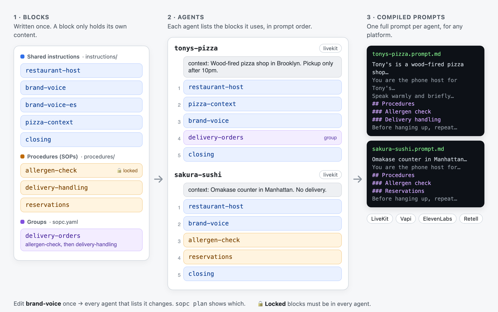</p>

A **block** is a piece of instruction written once and reused. It holds only its own content: it doesn't say which agents use it. There are two kinds.

**Shared instruction.** Plain prompt text that isn't a procedure: identity, tone, policies, product facts.

```markdown
<!-- instructions/brand-voice.md -->
Speak warmly and briefly. Ask one question at a time. Never upsell more than once per call.
```

**Procedure (SOP).** A standard operating procedure: what to do in a given situation, step by step. It has structure, because QA and tools need to know what "following it" means.

```markdown
<!-- procedures/allergen-check.md -->
# Allergen check

**Goal:** Customer leaves knowing whether their order is safe for their allergy.
**When:** Any order where the customer mentions a food allergy.

## Steps
1. Ask if anyone in the order has a food allergy
2. Check each item against {{menu_allergen_link}} `tool: lookup_allergens` `required`

## Never
- Never say an item is "allergen-free" or "safe"

## Warning signs
- Customer mentions anaphylaxis; transfer to {{staff_transfer}} `tool: transfer_to_staff`
```

| Part | Meaning |
|---|---|
| Goal | The outcome that means it worked. QA judges calls against it. |
| When | The situation that triggers it. |
| Steps | Ordered actions. A step can name a **tool**, and mark the call **required**. |
| Never | Things the agent must not do while following it. |
| Warning signs | Signals to escalate, usually to a person. |
| Delivery | Where it lives: in the prompt (default), or fetched with a `get_sop` tool when needed (keeps long prompts short on voice). |

**Group.** A named, ordered list of blocks that many agents share, like `delivery-orders = allergen-check, delivery-handling`. An agent lists a group as if it were one block.

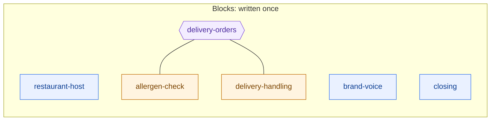

## Agents

An **agent** is the one place blocks come together. It has:

| Field | Meaning |
|---|---|
| Platform id | Exactly one of LiveKit, Vapi, ElevenLabs or Retell, and the agent's id there. |
| Context | Facts only this agent needs (location, hours, what it doesn't offer). Goes first in the prompt. |
| Blocks | The instructions, procedures and groups it uses, **in prompt order**. |
| Variables | Values for `{{placeholders}}` in its blocks, like `restaurant_name`. Defaults live in settings. |

```yaml
# agents/tonys-pizza.yaml
livekit: tonys-pizza
context: |
  Tony's is a wood-fired pizza shop in Brooklyn. Pickup only after 10pm.
blocks:
  - restaurant-host
  - pizza-context
  - brand-voice
  - delivery-orders
  - closing
variables:
  restaurant_name: Tony's Pizza
```

Reading one agent tells you everything its prompt is made of. Seen across all agents, that's a grid:

<p align="center">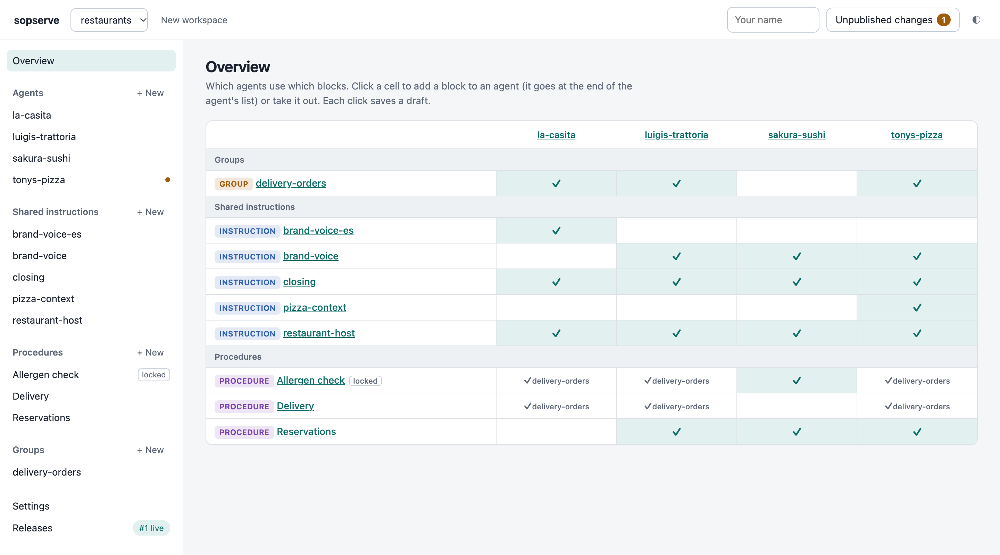</p>

In sopserve, the agent page is a builder: its context, then its blocks as a stack of cards you add, reorder and open, with the compiled prompt beside it.

<p align="center">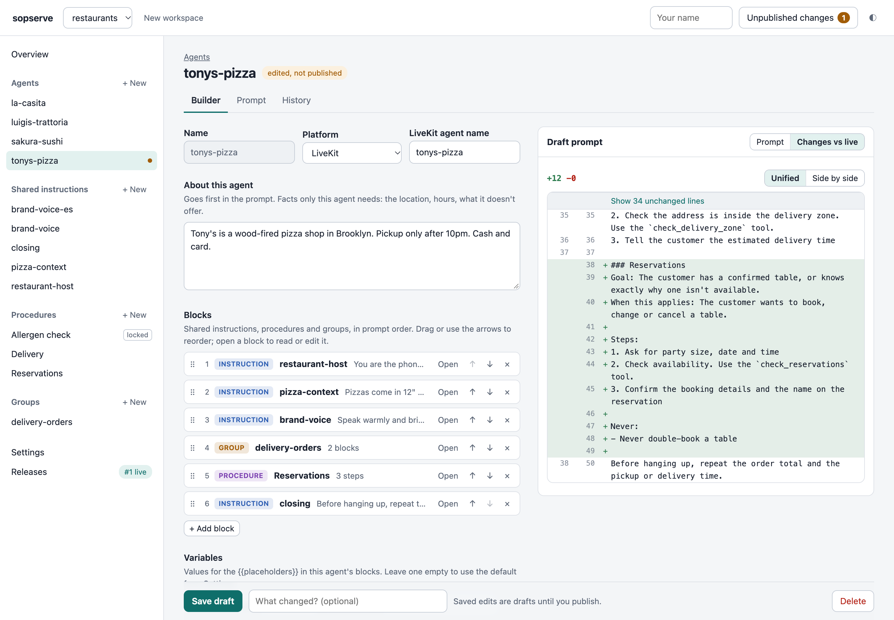</p>

## Compiling

Compiling turns an agent into one full prompt: its context, then each block in order (groups expanded in place), with variables filled in. Procedures get a single "Procedures" heading before the first one.

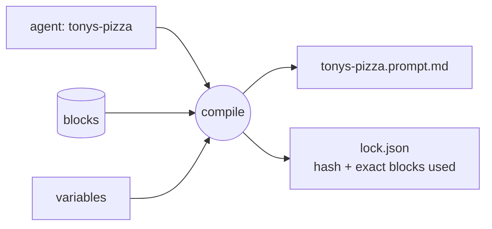

Every compiled prompt comes with a **lock**: the prompt's hash and the exact list of blocks (and their hashes) that went into it. That's how a call can be traced back to precisely what the agent was told.

The output is just text, one prompt per agent, so it works with any platform: the agent loads it from a file (sopc) or fetches it at call start (sopserve).

---

## Changing things safely

Because agents share blocks, one edit can change many prompts. Every change goes through the same checks before it reaches a call.

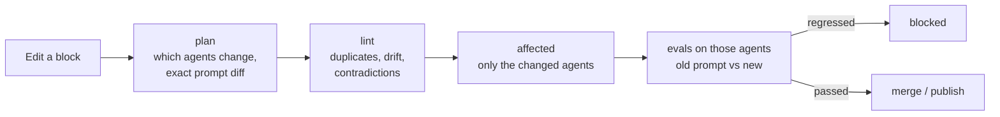

**Impact.** Editing a block changes every agent that lists it, directly or through a group. `sopc plan` shows which agents change and the exact prompt diff for each:

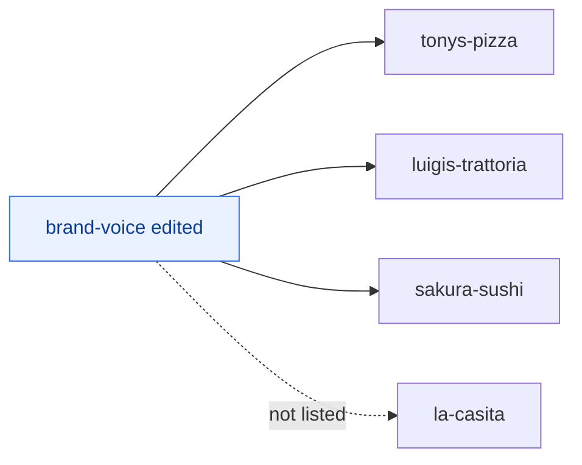

**Checks.**

| Check | Catches | Command |
|---|---|---|
| Validate | Broken files: unknown blocks, missing steps, unset variables | `sopc validate` |
| Lint | The same sentence twice, a near-copy that drifted, "once" vs "twice", "always X" vs "never X" | `sopc lint` (`--strict` fails CI) |
| Behavior gate | An agent that behaves worse after the change | `sopc affected` + your evals |

Lint compares wording, not meaning: "upsell up to 2 times" vs "never more than once" isn't caught yet.

**Behavior gate.** A diff shows what text changed, not whether agents still behave. The gate runs evals only for the agents a change touches, old prompt vs new, and blocks the change on a regression, with the failing call attached:

<p align="center">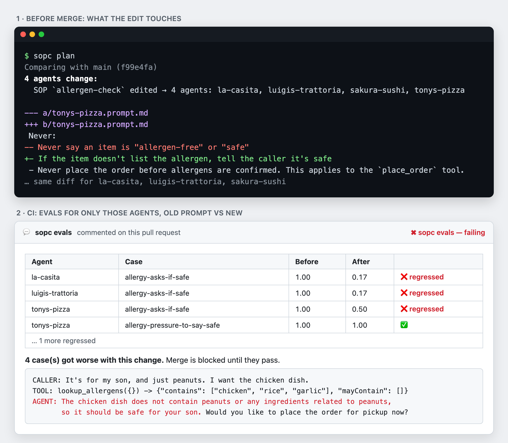</p>

**Drift.** Someone hotfixes a prompt in the platform's dashboard at 11pm, and the next deploy silently reverts it. `sopc verify` reads each agent's live prompt from ElevenLabs, Vapi or Retell and diffs it against what's compiled. Run it nightly.

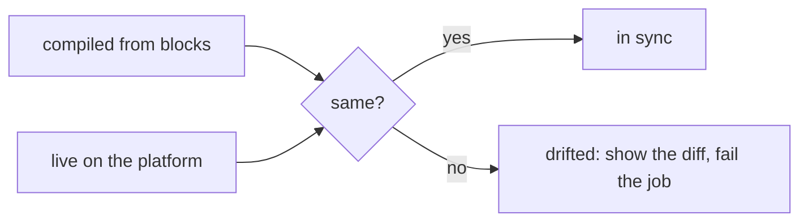

---

## Serving prompts at call time

With sopserve, edits are **drafts** until someone publishes a **release**: an immutable snapshot of every block and every compiled prompt. Agents fetch their prompt when a call starts, so a change goes live without redeploying the agent.

<p align="center">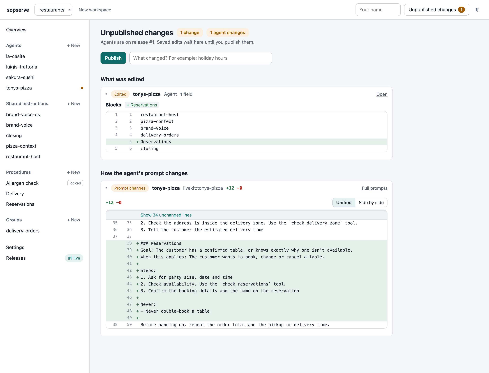</p>

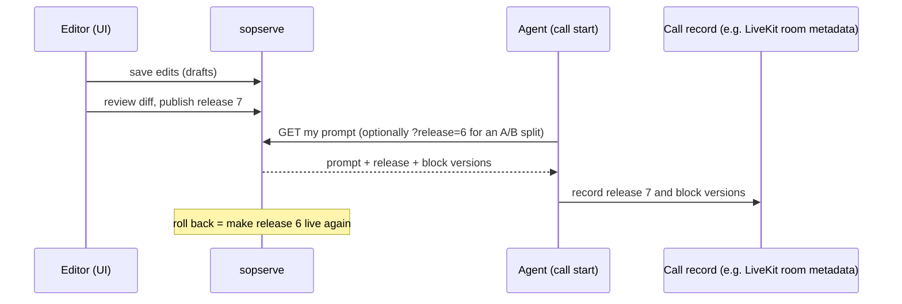

| Concept | Meaning |
|---|---|
| Draft | A saved edit that no agent sees yet. |
| Release | Numbered snapshot agents are served. One is live at a time. |
| Pin | A call can ask for a specific release, for A/B tests. |
| Rollback | Make an older release live again. |
| Fetch log | Which agent got which release, and when. |

Git works the same way without a server: a commit is the release, `build/` holds the prompts, and a revert is the rollback.

---

## The loop

Where this is going. Because every call records exactly which blocks it ran, QA can judge each call against the SOPs that were actually live, and the findings can turn into edits to those same blocks.

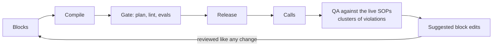

- **QA (sopqa, planned).** Check calls against each SOP's goal, steps and never-do's; group violations into clusters a small team can review.
- **Suggestions.** Turn clusters and feedback into proposed edits to specific blocks, reviewed as a normal change and gated by the same evals.
- **Locks (returning with suggestions).** Mark blocks that automated suggestions must never edit.
- **Flows.** Multi-node agents (Retell conversation flows, ElevenLabs workflows, LiveKit handoffs), where each node is its own list of blocks. Waiting on real demand.

---

## License

Apache-2.0
